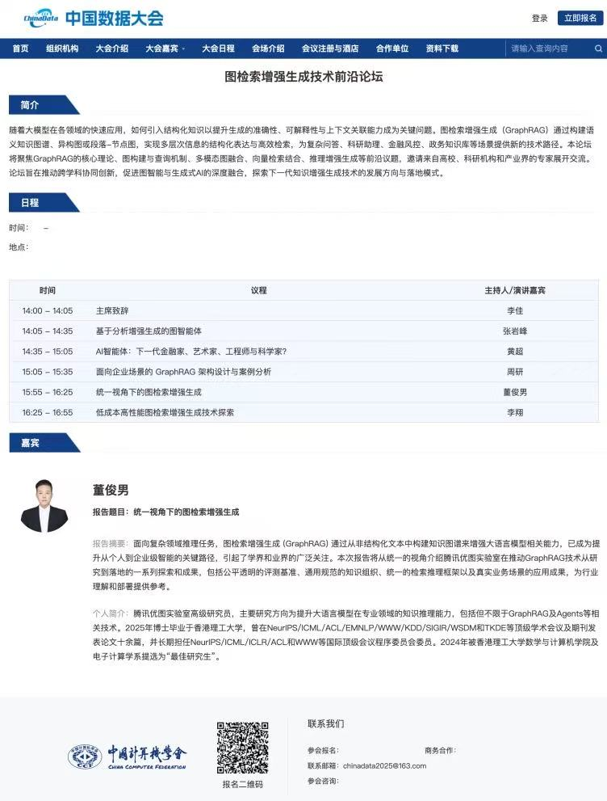
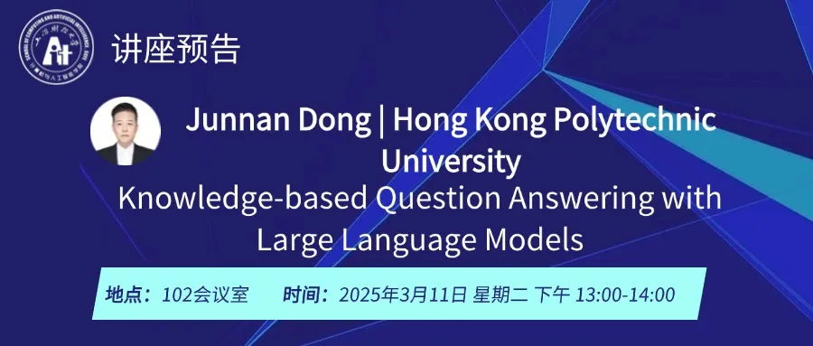

I am now a senior researcher at Tencent Youtu Lab, specializing in the research and development of Large Language Models and downstream directions. I obtained my Ph.D. degree from The Hong Kong Polytechnic University in 2025, Department of Computing, proudly advised by <a href="https://web.comp.polyu.edu.hk/xiaohuang/index.html">Prof. Xiao Huang</a> and <a href="https://www4.comp.polyu.edu.hk/~csqli/">Prof. Qing Li</a>. I have received  with ~40 papers published on top-tier conferences and journals, e.g., ICLR, NeurIPS, ICML, ACL, EMNLP, WWW, KDD, SIGIR, AAAI, WSDM and TKDE, etc.

I am currently passionate about researching: 
🥑 Large Language Models (LLMs): Inference Optimization, Diffusion Language Models 
🥨 Multimodal Large Language Models (MLLMs):  Native MLLMs, Interleaved Text-Image Data  
🥓 Agents:  Agentic Search, Agent Memory (Latent Reasoning, Compression)
🍤 Retrieval-Augmented Generation (RAG): GraphRAG, Agentic RAG, Multimodal RAG 

**We are actively recruiting 'Qingyun' Talent Program graduates and research interns to explore Agent, Memory, RAG, Multimodal Agent/RAG and related directions. Please feel free to drop me an email with your CV!** 

  
hanson[dot]{last_name}[at]connect[dot]polyu[dot]hk 

<h1>📣 Highlights</h1>
---
\[2026.05\] 🔥 We release the first survey of Native Multimodal Modeling, [Toward Native Multimodal Modeling: A Roadmap](https://nmm-roadmap.github.io/) 
\[2026.01\] 🎉 Our [Youtu-GraphRAG](https://github.com/TencentCloudADP/youtu-graphrag) has been accepted to ICLR 2026!  
\[2025.12\] We release [Youtu-LLM v1](https://huggingface.co/docs/transformers/model_doc/youtu), a super effective pre-trained 2B model for agents. 
\[2025.12\] I will give a talk at CCF ChinaData (中国数据大会), [GraphRAG Forum](https://ccf.org.cn/chinadata2025/schedule_d_4021), in Guiyang City. 
\[2025.10\] ✨ Our [Youtu-GraphRAG](https://github.com/TencentCloudADP/youtu-graphrag) has been admitted by the [DeepSeek Official Awesome Integrations](https://github.com/deepseek-ai/awesome-deepseek-integration). 
\[2025.05\] I passed the Ph.D. oral defense! Thanks to my distinguished panel members: [Prof.Yuanqing Zheng(PolyU)](https://www.polyu.edu.hk/comp/people/academic-staff/prof-zheng-yuanqing/), [Prof. Yangqiu Song (HKUST)](https://home.cse.ust.hk/~yqsong/), [Prof. Yixin Cao (FDU)](https://www.caoyixin.site/) 
\[2025.04\] I will join Tencent Youtu Lab through <b>`Qingyun' Top Talent Program</b> ([腾讯青云计划](https://join.qq.com/qingyun.html)). 
\[2025.03\] I will give a talk at SCAI-SHUFE about [KGQA with LLMs](https://mp.weixin.qq.com/s/olg0QBZkbt2fd206p69BMA). 
\[2025.02\] I am nominated by both the Department of Computing and the Faculty of Computer and Mathematical Science as the <b>Best Research Postgraduate Student</b> of 2024. 
\[2023.04\] I passed the confirmation as a Ph.D. Candidate. Thanks to the distinguished panel members: [Prof. Song Guo (HKUST)](https://cse.hkust.edu.hk/admin/people/faculty/profile/songguo) and [Prof. Bo Li (PolyU)](https://www4.comp.polyu.edu.hk/~bo2li/). 

<h1> 🕹 From Research to Production</h1>
---
[ 🚩[ICLR' 26]Youtu-GraphRAG](https://github.com/TencentCloudADP/youtu-graphrag) 
<!--   --> 
 
 [ 🚩 Deep Tabular Research](https://github.com/TencentCloudADP/youtu-graphrag) 
 

<h1>🎙 Talks</h1>
---
[CCF ChinaData 中国数据大会 - 🎈Graph+Agents](https://ccf.org.cn/chinadata2025/schedule_d_4021) 
 
[Tencent Youtu Lab - 🎈GraphRAG](https://mp.weixin.qq.com/s/JjVeO8rtqhuo9MeQgVJyOQ) 
 
[SCAI-SHUFE - 🎈KGQA with LLMs](https://mp.weixin.qq.com/s/olg0QBZkbt2fd206p69BMA) 

<h1>📻 Social Media</h1>
---
<b>🎈Youtu-LLM v1.0</b> 
[ModelScope](https://mp.weixin.qq.com/s/JJtQWSYEjnE7GnPkaJ7UNA),  
<b>🎈Youtu-GraphRAG v1.0</b> 
[机器之心](https://mp.weixin.qq.com/s/vm6yuZi4PIs2wizycnnfRg), [Tencent Cloud](https://mp.weixin.qq.com/s/Ddf3rpdJP8P_L5yaPnBFBA), [Tencent Youtu Lab](https://mp.weixin.qq.com/s/5DG_jC8ceIsaka7qqHaoNw) 
<b>🎈GraphRAG-Bench</b> 
[NebulaGraph Tech Community](https://www.nebula-graph.com.cn/posts/GraphRAG-Bench), [Tencent Youtu Lab](https://mp.weixin.qq.com/s/HUApXtD050i55g298rWFBg) 
<h1>✍ Services</h1>
---
<b>Program Committee Member</b> 
NeurIPS(2024-2025), ICML (2025-2026), ICLR (2025-2027), ACL (2025-2026), WWW (2024-2027), AAAI (2026-2027), WSDM 2027, NLPCC 2026  
<h1>🏆 Awards</h1>
---
2026 Tencent Outstanding Contributor 
2025 Best Research Postgraduate Student nominated by the Department of Computing in PolyU and Faculty of Computer and Mathematical Sciences. 
2025 Tencent 'Qingyun' Top Talent Program（青云计划） 
2025 Ant Group 'Ant Star' Top Talent Program（蚂蚁星） 
2024 NeurIPS Scholar Award 
2023 Hong Kong Polytechnic University Additional Top Conference Grant 

<h1>🚀 Selected Publications (first-/corresponding author)</h1>
---
* for co-first author, † for corresponding author  
<b>🕵 LLM Inference Optimization 🕵</b> 
1.【KV Cache Reuse】<b> [🌟Attuner: Recomputation-Free KV Cache Reuse via Query-Side Adaptation](https://arxiv.org/abs/2609.36722).</b> 
Xinghao Chen*, <b>Junnan Dong*</b>, Cai Ke, Chak Tou Leong, Haocheng Sun, Keyu Chen, Siyu An, Ruizhi Qiao, Xing Sun, Wenjie Li, Xiaoyu Shen 
arXiv 
2.【Diffusion LLMs】<b> [LADDER: Graph-Guided Diffusion Language Models for Efficient Multi-Hop Reasoning](https://arxiv.org/pdf/2609.24346).</b> 
Senlei Zhang, Linhao Luo, Qian-Wen Zhang, Siyu An, <b>Junnan Dong†</b>, Shuhao Zhang, Xing Sun 
arXiv  
<b>🤖 Agents 🤖</b> 
3.【Agentic RAG / GraphRAG】<b> [🌟Youtu-GraphRAG: Vertically Unified Agents for Graph Retrieval-Augmented Complex Reasoning](https://github.com/TencentCloudADP/youtu-graphrag).</b> 
<b>Junnan Dong</b>, Siyu An, Yifei Yu, Qian-wen Zhang, Linhao Luo, Xiao Huang, Yunsheng Wu, Di Yin, Xing Sun 
ICLR 2026  &nbsp;(✨admitted by the DeepSeek Official Awesome Integrations [Link](https://github.com/deepseek-ai/awesome-deepseek-integration)) 
4.【Agent Memory】<b> [Disentangling Long-Term Memory via Latent Neuro-Symbolic Reasoning](https://junnandong.github.io/).</b> 
Cai Ke, Xinghao Chen, Xiaoyu Shen, Keyu Chen, Siyu An, <b>Junnan Dong†</b>, Ruifeng Xu, Ruizhi Qiao, Xing Sun 
arXiv 
5.【Agent Memory】<b> [Latent Multimodal Memory Reasoning](https://junnandong.github.io/).</b> 
Cai Ke, Xinghao Chen, Yuanchen Bei, Yuni Lai, Keyu Chen, Ruizhi Qiao, Siyu An, <b>Junnan Dong†</b>, Ruifeng Xu, Xing Sun 
arXiv 
6.【Agentic RAG】<b> [Deep Tabular Research via Continual Experience-Driven Execution](https://arxiv.org/abs/2603.09151).</b> 
<b>Junnan Dong</b>, Chuang Zhou, Zheng Yuan, Yifei Yu, Siyu An, Di Yin, Xing Sun, Feiyue Huang 
arXiv 
7.【Agentic RAG】<b> [Cost-efficient Knowledge-based Question Answering with Large Language Models](https://proceedings.neurips.cc/paper_files/paper/2024/file/d0aafec03d59db29a92fa683bd783374-Paper-Conference.pdf).</b> 
<b>Junnan Dong</b>, Qinggang Zhang, Chuang Zhou, Hao Chen, Daochen Zha, Xiao Huang 
NeurIPS 2024 
8.【Agentic RAG】<b> 【[WFM: Wiki Foundation Model for Complex Agentic Reasoning](https://arxiv.org/pdf/2609.18182).</b> 
<b>Junnan Dong</b>, Linhao Luo, Senlei Zhang, Gong Chen, Taian Guo, Yifei Yu, Rong Tao, Tao Guo, Qian-Wen Zhang, Siyu An, Ruizhi Qiao, Xing Sun 
arXiv  
<b>🔍 RAG 🔍</b> 
9.【GraphRAG】<b> [HyperRAG: Query-centric Graph Retrieval-Augmented Generation with Hyperbolic Structuring](https://aclanthology.org/2026.acl-long.986.pdf).</b> 
Chuang Zhou, <b>Junnan Dong (Project Lead)</b>, Yilin Xiao, Su Dong, Shengyuan Chen, Di Yin, Xing Sun, Xiao Huang 
ACL Main 2026 
10.【GraphRAG】<b> [Collision to Cognition: Hash-Driven Graph Construction for Efficient RAG](https://aclanthology.org/2026.acl-long.1156.pdf).</b> 
Chuang Zhou, <b>Junnan Dong†</b>, Linhao Luo, Zhaozhuo Xu, Yilin Xiao, Siyu An, Di Yin, Xing Sun, Xiao Huang 
ACL Main 2026 
11.【GraphRAG】<b> [GraphRAG-Bench: Challenging Domain-Specific Reasoning for Graph Retrieval-Augmented Generation](https://arxiv.org/pdf/2506.02404).</b> 
Yilin Xiao*, <b>Junnan Dong*†</b>, Chuang Zhou, Su Dong, Qian-wen Zhang, Di Yin, Xing Sun, Xiao Huang 
arXiv 
12.【GraphRAG】<b> [KnowGPT: Knowledge Graph Prompting for Large Language Models](https://proceedings.neurips.cc/paper_files/paper/2024/file/0b8705a611ed1ce19cdb759031078705-Paper-Conference.pdf).</b> 
Qinggang Zhang*, <b>Junnan Dong*</b>, Hao Chen, Xiao Huang, Daochen Zha, Zailiang Yu 
NeurIPS 2024 
13.【Knowledge Graphs】<b> [Hierarchy-Aware Multi-Hop Question Answering over Knowledge Graphs](https://dl.acm.org/doi/pdf/10.1145/3543507.3583376).</b> 
<b>Junnan Dong</b>, Qinggang Zhang, Xiao Huang, Keyu Duan, Qiaoyu Tan, Zhimeng Jiang 
WWW 2023 
14.【Knowledge Graphs】<b>[Active Ensemble Learning for Knowledge Graph Error Detection](https://dl.acm.org/doi/pdf/10.1145/3539597.3570368).</b> 
<b>Junnan Dong</b>, Qinggang Zhang, Xiao Huang, Qiaoyu Tan, Daochen Zha, Zihao Zhao 
WSDM 2023 
15.【Knowledge Graphs】<b> [Gradual Study Advising with Course Knowledge Graphs](https://junnandong.github.io).</b> 
<b>Junnan Dong</b>, Wentao Li, Yaowei Wang, Qing Li, George Baciu, Jiannong Cao, Xiao Huang, Richard Li Chen, Peter Ng 
ICWL 2023  
<b>📽 Multimodal LLM and Evaluation 📽</b> 
16.【Native MLLM】<b>[🌟Toward Native Multimodal Modeling: A Roadmap](https://arxiv.org/pdf/2605.25343).</b> 
Siyu An*, Junru Lu*, <b>Junnan Dong*†</b> et al. 
EMNLP 2026 Findings 
17.【Visual QA】<b>[Modality-Aware Integration with Large Language Models for Knowledge-based VQA](https://arxiv.org/pdf/2402.12728).</b> 
<b>Junnan Dong</b>, Qinggang Zhang, Huachi Zhou, Daochen Zha, Pai Zheng, Xiao Huang 
ACL Main 2024 
18.【LLM Evaluation】<b>[CLR-Bench: Evaluating Large Language Models in College-level Reasoning](https://arxiv.org/pdf/2410.17558).</b> 
<b>Junnan Dong</b>, Zijin Hong, Yuanchen Bei, Feiran Huang, Xinrun Wang, Xiao Huang 
arXiv 

